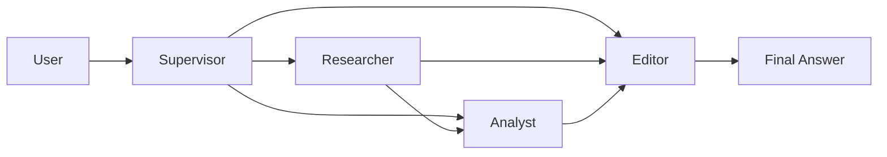

# Multi-Agent Local LLM Assistant

A local multi-agent assistant built with LangGraph and Ollama.
It routes user queries across specialized agents, uses web search for fresh context, and runs safe Python code for verification.

## Features

- 4-agent workflow: `supervisor`, `researcher`, `analyst`, `editor`
- Multi-model routing: `fast`, `accurate`, `auto`
- Web search tools: SearXNG (primary) + DuckDuckGo (fallback)
- Safe Python execution tool for calculations
- Structured JSON logging
- Unit tests for routing, tools, and error scenarios

## Architecture



## Tech Stack

- Python
- LangGraph / LangChain
- Ollama (local models)
- SearXNG

## Setup

```bash
python -m venv venv
source venv/bin/activate
pip install -r requirements.txt
cp .env.example .env
```

Pull local models (example):

```bash
ollama pull deepseek-coder:1.3b
ollama pull qwen3:1.7b
```

## Configuration

Important `.env` values:

- `MODEL_FAST`
- `MODEL_ACCURATE`
- `MODEL_MODE` (`auto`, `fast`, `accurate`)
- `SEARXNG_URL` (AWS-hosted endpoint supported, e.g. `http://<host>/search`)

## Run

Single query:

```bash
python main.py --mode auto "latest AI chip market news"
```

Interactive:

```bash
python demo.py --mode auto
```

## Tests

```bash
pytest tests/ -v
```

## Notes

- SearXNG is used as the primary engine because it benchmarked better in this project environment.
- DuckDuckGo remains enabled for fallback resilience.

## References

- LangGraph docs: https://docs.langchain.com/oss/python/langgraph/
- LangGraph repository: https://github.com/langchain-ai/langgraph
- Ollama docs: https://docs.ollama.com/
- SearXNG docs: https://docs.searxng.org/
- SearXNG Search API: https://docs.searxng.org/dev/search_api.html
- SearXNG container installation: https://docs.searxng.org/admin/installation-docker
- Python `ast` docs: https://docs.python.org/3/library/ast.html
- Python `subprocess` docs: https://docs.python.org/3/library/subprocess.html
- FrugalGPT paper (LLM cascades): https://arxiv.org/abs/2305.05176
- RouteLLM paper (LLM routing): https://arxiv.org/abs/2406.18665

https://gerred.github.io/building-an-agentic-system/core-architecture.html
https://medium.com/@anil.goyal0057/building-a-powerful-ai-agent-using-langchain-mistral-faiss-and-web-search-c9953751a1b2
https://medium.com/@elmo92/search-in-peace-with-searxng-an-alternative-search-engine-that-keeps-your-searches-private-accd8cddd6fc