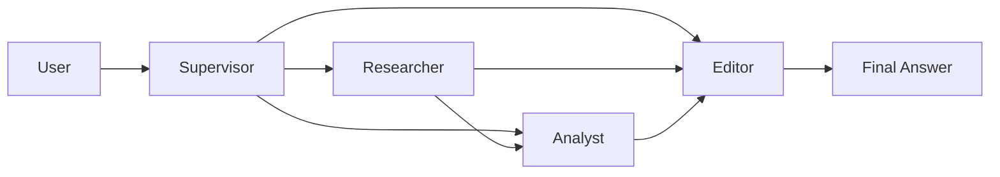

# Multi-Agent Local LLM Assistant

A local multi-agent assistant built with LangGraph and Ollama.
It routes user queries across specialized agents, uses web search for fresh context, and runs short Python calculations in a restricted process to check numbers.

## Features

- 4-agent workflow: `supervisor`, `researcher`, `analyst`, `editor`
- Multi-model routing: `fast`, `accurate`, `auto`
- Web search tools: SearXNG (primary) + DuckDuckGo (fallback)
- Python tool for calculations: the code is checked before it runs. Only a short list of
  modules (such as `math` and `statistics`) can be imported; `open`, `eval`, `exec`, system
  modules, attributes that start with `_` and access to running frames are blocked. The code
  then runs in a separate Python process with an empty environment, a 4-second time limit and
  capped output. This guards against mistakes, not against a determined attacker: Python cannot
  be fully locked down from inside, so use a container if the input is untrusted
- Structured JSON logging
- 83 unit tests for routing, tools and error cases; they run without Ollama or the internet

## Architecture



## Tech Stack

- Python
- LangGraph / LangChain
- Ollama (local models)
- SearXNG

## Setup

```bash
python -m venv venv
source venv/bin/activate
pip install -r requirements.txt
```

Pull local models (example):

```bash
ollama pull deepseek-coder:1.3b
ollama pull qwen3:1.7b
```

## Configuration

Settings are read from environment variables (for example `export MODEL_MODE=fast`).
The main ones, with their defaults:

| Variable | Default | Meaning |
|---|---|---|
| `MODEL_FAST` | `deepseek-coder:1.3b` | Small, fast Ollama model |
| `MODEL_ACCURATE` | `qwen3:1.7b` | Larger Ollama model |
| `MODEL_MODE` | `auto` | `auto`, `fast` or `accurate` |
| `SEARXNG_URL` | `http://localhost:8888/search` | Your SearXNG search endpoint |
| `SUPERVISOR_MODE` | `heuristic` | `heuristic`: route questions with keyword rules; anything else: ask the model |
| `EDITOR_MODE` | `llm` | `deterministic`: build news, fact and data reports without the model |

Web search tries SearXNG first. DuckDuckGo is the fallback: first directly, then through SearXNG,
and last through the `r.jina.ai` text mirror, a third-party service (set
`DUCKDUCKGO_PROXY_PREFIX` to change it).

## Run

Single query:

```bash
python main.py --mode auto "latest AI chip market news"
```

Interactive:

```bash
python demo.py --mode auto
```

## Tests

```bash
pytest tests/ -v
```

## Notes

- SearXNG is used as the primary engine because it benchmarked better in this project environment.
- DuckDuckGo remains enabled for fallback resilience.

## References

- LangGraph docs: https://docs.langchain.com/oss/python/langgraph/
- LangGraph repository: https://github.com/langchain-ai/langgraph
- Ollama docs: https://docs.ollama.com/
- SearXNG docs: https://docs.searxng.org/
- SearXNG Search API: https://docs.searxng.org/dev/search_api.html
- SearXNG container installation: https://docs.searxng.org/admin/installation-docker
- Python `ast` docs: https://docs.python.org/3/library/ast.html
- Python `subprocess` docs: https://docs.python.org/3/library/subprocess.html
- FrugalGPT paper (LLM cascades): https://arxiv.org/abs/2305.05176
- RouteLLM paper (LLM routing): https://arxiv.org/abs/2406.18665

https://gerred.github.io/building-an-agentic-system/core-architecture.html
https://medium.com/@anil.goyal0057/building-a-powerful-ai-agent-using-langchain-mistral-faiss-and-web-search-c9953751a1b2
https://medium.com/@elmo92/search-in-peace-with-searxng-an-alternative-search-engine-that-keeps-your-searches-private-accd8cddd6fc